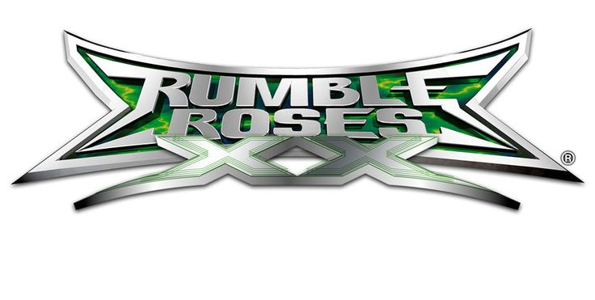

<p align="center">
  
</p>

# Rumble Roses XX — PC recomp (unofficial)

An unofficial, work-in-progress **native PC port of Rumble Roses XX (Xbox 360, 2006)**, made by *static
recompilation*: the game's PowerPC code is translated to C++ and compiled for x86-64 with the
[ReXGlue SDK](https://github.com/rexglue/rexglue-sdk) (a toolkit derived from the Xenia emulator). It is
not an emulator that runs the console image: you recompile **your own** copy of the game on **your own** PC.

> **Status: alpha / WIP.** The game boots, plays the intro video, reaches the menus, and full matches are
> playable with a gamepad. It has been **tested on a single PC** (Windows 11, integrated Intel UHD graphics).
> **Reports from other GPUs / drivers are exactly what this release is looking for** — see
> [Reporting bugs](#reporting-bugs). Expect rough edges.

> **No game files are included, and none ever will be.** You need your own legal copy of the game.
> This project is not affiliated with, endorsed by or connected to Konami or Yuke's.

*(Resumen en español al final de este archivo — [ir a la sección en español](#español).)*

---

## Contents
- [Requirements and tested hardware](#requirements-and-tested-hardware)
- [Getting the game files from your own copy](#getting-the-game-files-from-your-own-copy)
- [Easy install (setup.bat)](#easy-install-setupbat)
- [Manual build (advanced)](#manual-build-advanced)
- [Running and configuration](#running-and-configuration)
- [Known issues](#known-issues)
- [Reporting bugs](#reporting-bugs)
- [How it works / repository layout](#how-it-works--repository-layout)
- [Credits](#credits) · [License](#license) · [Español](#español)

## Requirements and tested hardware
| | |
|---|---|
| OS | Windows 10/11, 64-bit (Linux / Steam Deck is a future goal, not available yet) |
| GPU | Direct3D 12 capable. **Tested only on an integrated Intel UHD GPU (Windows 11).** NVIDIA / AMD: untested |
| Disk | ~25 GB free (ISO extraction ≈ 4 GB, SDK + game build ≈ 15 GB) |
| Time | 30–90 min the first time (mostly compiling; 20+ minutes for the SDK alone) |
| Input | An Xbox-compatible gamepad is recommended (tested). Local multiplayer is a goal but untested |
| Tools | Visual Studio 2022 Build Tools (C++ workload), LLVM/clang, CMake, Ninja, Git, Python 3 — `setup.bat` installs what is missing (with your confirmation) |
| Game | **Your own copy** of Rumble Roses XX (Xbox 360 retail disc → ISO) |

Online play (Xbox Live) is out of scope.

## Getting the game files from your own copy
The recompiler needs the files of the original disc, extracted from **your own** physical copy:

1. Make a disc image (`.iso`) of **your own Rumble Roses XX Xbox 360 disc** with a compatible DVD drive
   or a console you own, using the dumping method of your choice for discs you own.
2. Keep the `.iso` somewhere safe on your PC. `setup.bat` will ask for its path.
3. `setup.bat` extracts it next to this folder into `..\rrxx_data\extraido\` (so it is never inside the
   repository) with [extract-xiso](https://github.com/XboxDev/extract-xiso). The SDK then reads
   `default.xex` directly and decrypts/decompresses it itself — there is **no separate decryption step** and no
   key is needed from you.

This repository does not link to, host, or recommend any place to obtain game files.

## Easy install (setup.bat)
1. Clone this repository to a **short path** without spaces, outside protected folders:
   ```
   git clone https://github.com/JesusTaylo/rumble-roses-xx-recomp.git C:\rrxx\rrxx-recomp
   ```
   (no `--recursive` needed: the setup script fetches the SDK). If Windows Defender's *Controlled folder access* is on, avoid
   `Documents`/`Desktop`, it blocks compiler output there.
2. Double-click **`setup.bat`** (or run `setup.bat "D:\path\to\your-game.iso"`; you can also drag the ISO onto it).
3. Follow the prompts. It will, in order:
   1. ask for your ISO (or accept it as an argument);
   2. check Git, Visual Studio Build Tools (C++), LLVM/clang, CMake, Ninja and Python — and install what is
      missing with `winget`, **asking first** (Windows may show an administrator prompt);
   3. extract the ISO to `..\rrxx_data\extraido\`;
   4. fetch the ReXGlue SDK, apply our patches (`third_party/patches`) and build it;
   5. let the SDK recompile `default.xex` to C++ (`generated\`, never shared) and build `rrxx.exe`;
   6. create **`jugar.bat`** and a shortcut **`Rumble Roses XX.lnk`** with the game icon.
4. Play with `jugar.bat` (or the shortcut).

Setup is safe to re-run: finished steps are skipped. Logs go to `logs\` (`setup.log`, `build_sdk.log`,
`build.log`, `codegen.log`). Nothing is uploaded and no game data is stored in the repository.

If a step fails the script says which one, where the log is, and how to continue. Typical fixes:
winget missing → update *App Installer* from the Microsoft Store; "tool installed but not found" → close the
window and run `setup.bat` again; build errors under `Documents` → move the repo to e.g. `C:\rrxx\`.

## Manual build (advanced)
Equivalent to what `setup.bat` does, step by step (PowerShell, from the repository folder, after the `git clone` above):

```powershell
# 0. Tools (once): Git, VS 2022 Build Tools with the "Desktop development with C++" workload,
#    LLVM, CMake, Ninja, Python 3
winget install Git.Git LLVM.LLVM Kitware.CMake Ninja-build.Ninja Python.Python.3.12
winget install Microsoft.VisualStudio.2022.BuildTools --override "--passive --wait --add Microsoft.VisualStudio.Workload.VCTools --includeRecommended"

# 1. Extract YOUR ISO next to the repo folder (outside the repo). extract-xiso is a small C tool:
git clone https://github.com/XboxDev/extract-xiso build\tools\extract-xiso
git -C build\tools\extract-xiso checkout 3f5b62c
cmake -S build\tools\extract-xiso -B build\tools\extract-xiso\build -G Ninja -DCMAKE_BUILD_TYPE=Release   # from a VS x64 developer prompt
cmake --build build\tools\extract-xiso\build
build\tools\extract-xiso\build\extract-xiso.exe -d ..\rrxx_data\extraido -x "D:\path\to\your-game.iso"
#    -> ..\rrxx_data\extraido\default.xex must exist

# 2. SDK: fetch submodules, fix Windows symlink stubs, apply patches, build + install to build\sdk-install
powershell -ExecutionPolicy Bypass -File tools\prepare_sdk.ps1
powershell -ExecutionPolicy Bypass -File tools\build_sdk.ps1        # 20-60 min, log: logs\build_sdk.log

# 3. Recompile default.xex -> generated\ (C++), configure and build the game
powershell -ExecutionPolicy Bypass -File tools\build.ps1 -Codegen   # preset dev-release-opt; output build\dev-release-opt\rrxx.exe

# 4. Run (log: logs\run_<date>.log; on crash a summary goes to logs\ultimo_crash.txt)
powershell -ExecutionPolicy Bypass -File tools\run.ps1 -NoBuild
```

`tools\env.ps1` locates MSVC (via `vswhere`), clang, CMake and Ninja for you; the CMake presets are in
`CMakePresets.json` (`dev-release-opt` = Release, `-march=native`, LTO; `dev-relwithdebinfo` for debugging).
Because the SDK is patched, build **our** SDK checkout (do not use a stock ReXGlue release).

## Running and configuration
`jugar.bat` → `tools\run.ps1`. The first run copies `config\rrxx.toml` next to `rrxx.exe`
(`build\dev-release-opt\rrxx.toml`); edit **that copy** and restart (no rebuild needed). Any ReXGlue cvar can be
set there or on the command line, e.g. `tools\run.ps1 -NoBuild -GameArgs '--fullscreen=false'`.

| Option | Default | What it does |
|---|---|---|
| `render_target_path_d3d12` | `"rtv"` | `"rtv"`: host render targets, fast (≈2.7× faster than `rov` on Intel UHD in our test). `"rov"`: pixel-shader-interlock path, more exact but slow. `""`: SDK decides (ROV on Intel). If you see graphical errors, try `"rov"` |
| `resolution_scale` | `1` | Internal resolution multiplier (1 = 720p, 2 = 1440p…). Restart needed |
| `gpu_log_fps` | `5` | Print FPS to the log every N s (`0` = off). Handy for performance reports |
| `d3d12_upload_page_guard_margin` | `true` | 64 KB safety margin at the end of upload-pool pages: the **mitigation for the GPU crash (TDR)**. Set `false` only to compare |
| `--skip_movies=true` (CLI) | `false` | Skip the intro videos |
| `--fullscreen=false`, `--vsync=false` (CLI) | `true` / `true` | Window mode / vertical sync (ReXGlue cvars) |
| `--input_script=<file>` / `--input_record=<file>` (CLI) | off | Record or replay virtual-controller input (developer tool) |

Cache and photo folders (`CACHE:\`, `PHOTO:\` in the game) are mapped to `Documents\rrxx\guest_cache` and
`Documents\rrxx\photos`.

## Known issues
- **Video is posterized / low quality** (probably the XMV decoding path; not investigated yet). The intro and menu videos play, but
  colors look banded. Not investigated further.
- **GPU crash ("device removed" / TDR) on Intel UHD — mitigated, root cause pending.** Originally the driver
  reset the GPU after ~3 minutes (6 of 10 idle runs), always in a `DrawIndexedInstanced` whose fault address was the
  end of a constant-buffer upload page. A 64 KB margin at the end of those pages (`d3d12_upload_page_guard_margin`,
  on by default) removed it in testing (0/15 idle runs; two matches plus several visits to the customisation
  menu without a crash). **Why the GPU reads past the end is still unknown**; other GPUs may behave
  differently. Details: [`docs/CRASHES.md`](docs/CRASHES.md) #7 and [`third_party/patches/README.md`](third_party/patches/README.md).
- Performance on an integrated GPU is modest (roughly 45–60 FPS on title/intro scenes, 30 when vsync-bound; some
  stutter). Other hardware is unmeasured.
- Alpha: several kernel/GPU edge cases print warnings in the log (invalid texture fetch constants, a few stubbed
  system calls). Most do not affect play, but please report visible problems.
- Only a single machine was used for testing. Local multiplayer (several pads) is untested.
- **Online / Xbox Live is out of scope** (the game is expected to run in "offline" mode).

## Reporting bugs
Open a GitHub issue with the **Bug report** form. Please include:
- **GPU model and driver version** (Device Manager → Display adapters), Windows version, CPU/RAM, laptop or desktop
  (and whether there are two GPUs).
- **What you did**: which menu/mode/character, how long after launch, always or random.
- **The summary of the crash**: after a crash `jugar.bat` writes `logs\ultimo_crash.txt`. To regenerate it from any run log:
  ```powershell
  python -I tools\triage.py logs\run_<date>.log
  ```
  (add `--native crash_dumps\native_<date>.txt` if that file exists). It prints the guest address, the
  recompiled function, host stack, DRED page-fault info and the last relevant log lines — no game content.
- Any change you made to `rrxx.toml` / command line.

**Never attach game files, `generated\` code, shader dumps, memory dumps (`.dmp`) or screenshots containing
assets you cannot share.** `logs\setup.log`, `logs\run_*.log`, `ultimo_crash.txt` are OK to share.
FPS data (`gpu_log_fps`) in the log is very welcome for performance reports. For a repeatable stability test,
`tools\timing_test.py` runs N unattended 3-minute sessions and writes a CSV.

## How it works / repository layout
```
setup.bat / setup.ps1   guided install
config/overrides.toml   recompiler overrides: function entry points the static analysis missed (addresses only)
config/rrxx.toml        default runtime options
rrxx_manifest.toml      ReXGlue project file (paths are relative to this repo)
src/                    host app: window, icon, CACHE:/PHOTO: mounts, crash handler (minidump + symbolised stack)
resources/              icon + Windows resource file
third_party/rexglue-sdk SDK (git submodule, pinned)      third_party/patches/  our SDK patches + explanations
tools/                  build/run/triage scripts          docs/                  crash log (CRASHES.md), dev log, notes
```
Pipeline: `default.xex` (decrypted/decompressed by the SDK) → `rexglue codegen` → C++ in `generated\` → clang →
`rrxx.exe` linked with the SDK runtime (kernel/XAM HLE, Xenos GPU on D3D12, XMA/XMV, input).
The docs under `docs/` (and `CLAUDE.md`) are the development log and are mostly in Spanish.

## Credits
- **Rumble Roses XX** © Konami / Yuke's. This is a fan project with **no affiliation** with Konami or Yuke's.
- **[ReXGlue SDK](https://github.com/rexglue/rexglue-sdk)** (Tom Clay and contributors) — the static recompilation
  toolkit and runtime this port is built on.
- **[Xenia](https://xenia.jp)** — ReXGlue derives from the Xenia Xbox 360 emulator (Ben Vanik and the Xenia contributors).
- **[Banjo-Tooie XBLA recomp](https://github.com/iron-jay/banjo_tooie_xbla_recomp)** by iron-jay — used as the reference for project
  structure and workflow.
- **[extract-xiso](https://github.com/XboxDev/extract-xiso)** — ISO extraction. **SDL3**, **FFmpeg**, **DXC**, etc. via the SDK.
- Developed with the help of **[Claude Code](https://claude.com/claude-code)** (Anthropic) as a programming partner.

## Trademarks and logo
The *Rumble Roses XX* logo at the top of this page (`resources/branding/rumble_roses_xx_logo.png`) is a trademark and copyrighted artwork of **Konami Digital Entertainment / Yuke's**. It is shown here only to identify the game this fan project is about; it is **not** covered by this project's license, and no endorsement, affiliation or ownership is claimed. All rights to the name, logo and game belong to their owners. If you are a rights holder and want it removed, please open an issue and it will be taken down promptly.

## License
This project's own code is licensed under the [BSD 3-Clause License](LICENSE) (Copyright (c) 2026 JesusTaylo). The SDK in `third_party/rexglue-sdk` and
the patches in `third_party/patches` are BSD-3-Clause (ReXGlue / Xenia). The game itself is **not** covered by
any license here and is **not** included: you must own a copy.

---

## Español
Port **no oficial** de **Rumble Roses XX (Xbox 360)** a PC por **recompilación estática** (PowerPC → C++ con el
SDK ReXGlue). **Alpha / en desarrollo.** Probado solo en **un PC** (Windows 11, GPU integrada Intel UHD): se buscan
reportes con **otras GPUs y drivers**.

**No incluye ningún archivo del juego**: necesitas tu propia copia legal. Sin afiliación con Konami ni Yuke's.

**Instalación fácil:** clona el repo en una ruta corta (por ejemplo `C:\rrxx\rrxx-recomp`, fuera de `Documentos`)
con `git clone https://github.com/JesusTaylo/rumble-roses-xx-recomp.git C:\rrxx\rrxx-recomp`, y ejecuta **`setup.bat`** (o `setup.bat "D:\ruta\tu-juego.iso"`). Pide la ISO de *tu* disco, instala con `winget`
(preguntando antes) lo que falte, extrae la ISO a `..\rrxx_data\extraido`, compila el SDK con nuestros parches,
recompila `default.xex` (el SDK lo descifra solo) y compila el juego. Al final crea `jugar.bat` y un acceso
directo con el ícono. Se puede repetir sin problema (salta lo ya hecho). Los mensajes del script salen en español
si tu Windows está en español. Compilación manual paso a paso: ver la sección *Manual build*.

**Opciones** en `config\rrxx.toml` (la copia que queda junto a `rrxx.exe` tras la primera ejecución): ruta de render
(`rtv` rápido / `rov` exacto), `resolution_scale`, `gpu_log_fps`, y los dos ajustes del crash de GPU. Ver la tabla
de arriba.

**Problemas conocidos:** video posterizado; el crash de GPU (TDR) en Intel UHD está **mitigado** con un margen de
64 KB (`d3d12_upload_page_guard_margin`) pero la **causa de fondo sigue sin encontrarse**; el modo online queda
fuera de alcance.

**Reportar bugs:** abre un issue con la plantilla e incluye modelo de GPU y driver, Windows, pasos para reproducir y
la salida de `logs\ultimo_crash.txt` (o `python -I tools\triage.py logs\run_<fecha>.log`). **No adjuntes archivos
del juego ni código generado.**

Créditos: Konami/Yuke's (sin afiliación), ReXGlue, Xenia, el port de Banjo-Tooie de iron-jay como referencia, y
desarrollado con ayuda de Claude Code.
